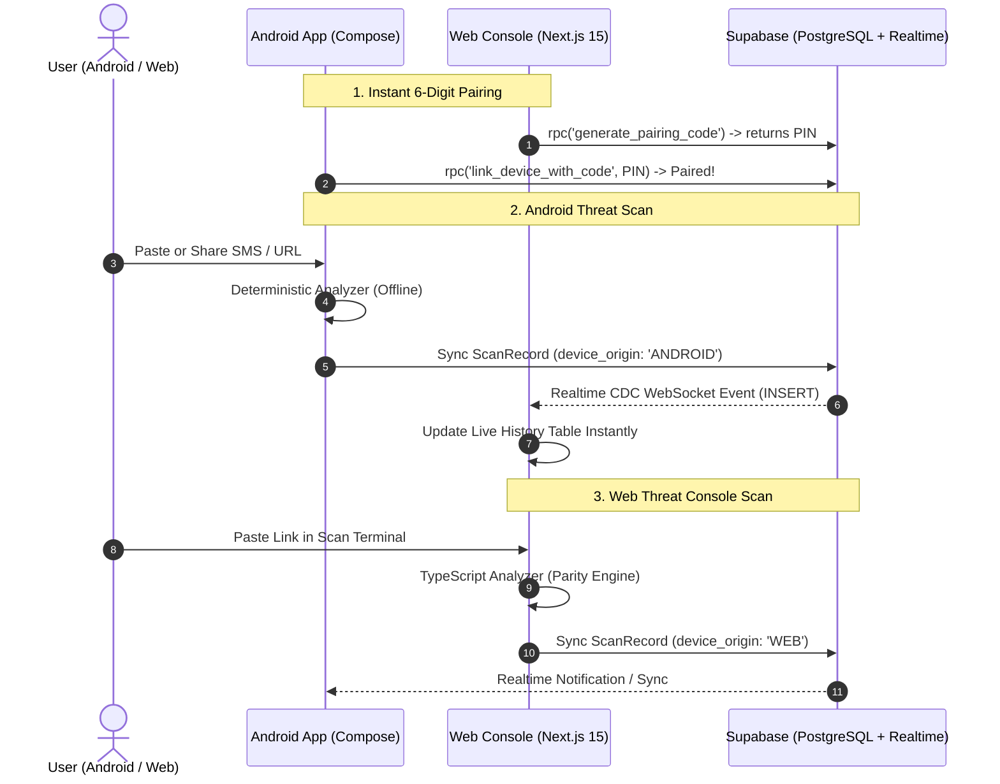

# PauseLink 🔗🛡️

> **Full-Stack, Cross-Platform Suspicious-Link & Threat Analysis Engine**
> Native Android (Compose + Kotlin) & Web Application (Next.js 15 + Supabase Realtime) with Zero-Network Deterministic Heuristics.

[](https://developer.android.com)
[](https://nextjs.org)
[](https://supabase.com)
[](https://kotlinlang.org)
[](https://turbo.build)
[]()

---

## 📖 Overview

**PauseLink** is a privacy-first, cross-platform security platform engineered to analyze suspicious links, phishing SMS messages, and QR payloads without compromising user confidentiality or device safety.

Unlike conventional security apps and cloud scanners that send links to external servers (risking token leaks, tracking exposure, webhook triggers, or drive-by compromises), **PauseLink's core analyzer operates with zero external network resolution**. All heuristic analysis is performed entirely offline using deterministic Kotlin and TypeScript engines with 100% test vector parity.

The system features:
- **Native Android App** (`apps/android`): Jetpack Compose, Material 3, Hilt, Room, and pure Kotlin/JVM `:analyzer`.
- **Next.js 15 Web Console** (`apps/web`): React 19, Tailwind CSS, TanStack Query, live threat terminal, and reactive audit logs.
- **Supabase Realtime Cloud Sync** (`packages/supabase-config`): Bidirectional WebSocket synchronization using PostgreSQL 16 Change Data Capture (CDC), Row-Level Security (RLS), and a 6-digit device pairing protocol.
- **Shared Type Safety** (`packages/types`): End-to-end typed contracts (`@pauselink/types`).

---

## 🏛️ Full-Stack Monorepo Architecture

```
PAUSELINK/
├── apps/
│   ├── android/                  # Native Android application
│   │   ├── analyzer/             # Pure Kotlin/JVM threat extraction engine (zero network)
│   │   ├── app/                  # Compose UI, Navigation, Hilt DI, Cloud Sync layer
│   │   └── build.gradle.kts
│   └── web/                      # Next.js 15 full-stack application
│       ├── app/                  # App Router: /, /history, /pair, /login
│       ├── components/           # ScanTerminal, LiveHistoryTable, FindingDetailDialog
│       ├── hooks/                # useRealtimeScans (Supabase CDC subscription)
│       └── lib/analyzer/         # TypeScript port with 100% test parity
├── packages/
│   ├── types/                    # Shared DTOs and models (@pauselink/types)
│   └── supabase-config/          # SQL migrations, RLS policies, pairing procedures
├── docs/                         # Architecture blueprints & setup guides
│   ├── CROSS_PLATFORM_SETUP.md   # Supabase & monorepo guide
│   └── PauseLink_Blueprint.md    # Native Android blueprint
└── turbo.json                    # Turborepo task pipeline
```

---

## 🔄 Cross-Platform Real-Time Flow



---

## 🛡️ Non-Negotiable Privacy & Security Guarantees

1. **Deterministic Offline Analysis**: Neither the Android analyzer nor the Web analyzer connects to the internet to fetch, expand, or preview links. All findings are derived strictly from syntactic and morphological indicators.
2. **Never Opens Links**: Links inside PauseLink are strictly non-clickable. Users can safely copy sanitized URLs.
3. **Zero Raw Input Logging**: The `AppLogger` contract permits logging only rule IDs, counts, durations, and exception class names. Raw URLs, hosts, paths, query parameters, and message contents are never logged.
4. **ReDoS Immunity**: URL extraction uses linear character-by-character scanning with no nested regex quantifiers, provably immune to catastrophic backtracking.
5. **No Dangerous Sensationalism**: PauseLink avoids misleading binary labels like "virus" or "safe". It provides factual, educational breakdowns of observed signals and standardized risk bands (`NO_WARNING_SIGNS`, `NOTICE`, `CAUTION`, `STRONG_WARNING`).

---

## 🚀 Quick Start & Development

### 1. Web Application (`apps/web`)

```bash
# Install dependencies across all monorepo workspaces
npm install

# Build shared types package
npm run build -w packages/types

# Run unit tests for TypeScript analyzer (100% parity verified)
npm run test -w apps/web

# Start Next.js 15 development server
npm run dev -w apps/web
```
Access the console at [http://localhost:3000](http://localhost:3000).

### 2. Android Application (`apps/android`)

```bash
cd apps/android

# Run analyzer tests
./gradlew :analyzer:test

# Run unit tests and assemble debug APK
./gradlew :app:testDebugUnitTest :app:assembleDebug
```
Debug APK generated at: `apps/android/app/build/outputs/apk/debug/app-debug.apk`.

### 3. Database & Cloud Sync (`packages/supabase-config`)

Apply migrations in your Supabase project:
1. `packages/supabase-config/migrations/20261114000001_initial_schema.sql`
2. `packages/supabase-config/migrations/20261114000002_device_pairing.sql`

Configure environment variables in `apps/web/.env.local`:
```bash
NEXT_PUBLIC_SUPABASE_URL=https://your-project.supabase.co
NEXT_PUBLIC_SUPABASE_ANON_KEY=your-anon-key
```

---

## 📱 Features

- **Multi-Source Ingestion**: Pasted text, shared SMS messages, and QR payloads.
- **Explainable Findings**: 25 standardized rule codes (`U001` - `U017`, `M001` - `M006`, `Q001` - `Q002`) with observable evidence.
- **Anonymous-First Pairing**: 6-digit PIN device linking without mandatory accounts.
- **Cross-Platform Sync**: Instant WebSocket state synchronization between mobile and web.
