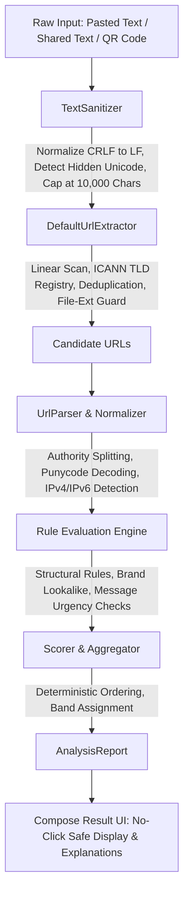
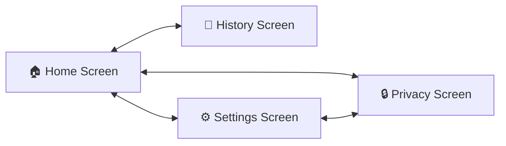

# PauseLink 🔗🛡️

> **Offline-first, deterministic, explainable suspicious-link and message analysis for Android.**

[](https://developer.android.com)
[](https://kotlinlang.org)
[](https://developer.android.com/jetpack/compose)
[-brightgreen.svg)]()
[]()
[-red.svg)]()
[]()

---

## 📖 Overview

**PauseLink** is a privacy-first native Android security tool engineered to analyze suspicious links, phishing SMS messages, and QR payloads without compromising user confidentiality or device safety.

Unlike conventional security apps and cloud scanners that send links to external servers (risking token leaks, tracking exposure, webhook triggers, or drive-by compromises), **PauseLink operates with zero network access**. All analysis is performed entirely on-device using a pure, deterministic Kotlin heuristic engine.

PauseLink does not declare the `android.permission.INTERNET` permission, never fetches or expands web links, and enforces a strict architectural boundary ensuring raw URLs and personal message texts are never logged or transmitted.

---

## 🏛️ Architecture & Module Structure

PauseLink is designed as a decoupled, multi-module project enforcing strict separation between Android platform code and core security analysis logic:

```
PAUSELINK/
├── analyzer/                 # Pure Kotlin/JVM Module (Zero Android dependencies)
│   ├── src/main/kotlin/com/clickretina/pauselink/analyzer/
│   │   ├── AnalyzerConfig.kt # Configurable limits (10k chars, 10 links, 2048 max URL)
│   │   ├── model/            # Domain models (RuleId, Finding, LinkReport, RiskAssessment)
│   │   ├── extract/          # ReDoS-resistant linear URL extraction & sanitization
│   │   └── unicode/          # Invisible and bidirectional Unicode character detection
│   └── src/main/resources/   # Bundled IANA/ICANN TLD registry
│
├── app/                      # Android Application Module
│   ├── src/main/java/com/clickretina/pauselink/
│   │   ├── PauseLinkApplication.kt  # @HiltAndroidApp application entrypoint
│   │   ├── MainActivity.kt          # Single-activity container with adjustResize
│   │   ├── di/                      # Dependency Injection (Hilt + Coroutine dispatchers)
│   │   ├── navigation/              # Type-safe Jetpack Navigation Compose (@Serializable)
│   │   ├── platform/                # AppLogger (Zero-leak structured metric logging)
│   │   └── ui/                      # Jetpack Compose UI (Theme, Scaffold, Screens)
│   └── src/main/res/                # Material 3 themes, icons, and localized resources
│
└── docs/                     # Architectural specifications and engineering notes
    ├── PauseLink_Blueprint.md       # Comprehensive technical blueprint
    ├── ENGINEERING_NOTES.md         # Incident logs and toolchain records
    └── VERSIONS.md                  # Pinned and verified library versions
```

---

## 🔄 Processing Pipeline

PauseLink analyzes incoming text through a deterministic, linear processing pipeline:



---

## 🛡️ Non-Negotiable Privacy & Security Guarantees

- **No `INTERNET` Permission**: PauseLink has zero network code. It cannot perform HTTP requests, DNS queries, or socket connections.
- **Never Fetches or Opens Links**: Links inside PauseLink are strictly non-clickable (`ClickableText` and `ACTION_VIEW` are banned). Users can only inspect and safely copy sanitized links.
- **No Raw Input Logging**: The `AppLogger` contract permits logging only rule IDs, counts, durations, and exception class names. Raw URLs, hosts, paths, query parameters, and message contents are never logged.
- **Display Spoofing Mitigation**: Bidirectional overrides (e.g. `U+202E`) and zero-width characters are explicitly flagged and tokenized to protect users from visual spoofing.
- **ReDoS Immunity**: URL extraction uses linear character-by-character scanning with no nested regex quantifiers, provably immune to catastrophic backtracking.
- **Explainable Results**: PauseLink never uses sensationalist labels like "virus" or "safe". It provides factual, educational breakdowns of observed signals and risk bands (`NO_WARNING_SIGNS`, `NOTICE`, `CAUTION`, `STRONG_WARNING`).

---

## 📱 User Interface & Navigation

PauseLink features a modern, clean Jetpack Compose Material 3 interface organized into four primary top-level destinations with seamless bottom navigation:



### Screen Overview

| Screen | Purpose & Architecture |
|---|---|
| **🏠 Home Screen** | Text input area for pasting or typing suspicious links/messages, quick action buttons (Analyze, Clear), input length indicators, and direct access to analysis. |
| **📜 History Screen** | App-private, minimized local analysis history. Allows reviewing previous risk bands or clearing saved items with undo capabilities. |
| **⚙️ Settings Screen** | Privacy-centric preferences (History storage toggle, QR code auto-scan settings) stored via DataStore Preferences. |
| **🔒 Privacy Screen** | Complete transparency report explaining the app's zero-permission sandbox, data minimization policies, local processing limits, and security boundaries. |

---

## 🚀 Recent Updates & Milestone Progress

PauseLink is being developed strictly according to its engineering blueprint across twelve disciplined milestones:

- [x] **M0: Toolchain & Baseline Setup**
  - Configured Gradle 9.6, AGP 9.5.1, Kotlin 2.2.10, Java 17/25 JBR.
  - Initialized isolated workspace and verified baseline dependencies in `docs/VERSIONS.md`.
- [x] **M1: Project Skeleton & Navigation**
  - Created pure Kotlin/JVM `:analyzer` module and connected it to `:app`.
  - Configured Dagger Hilt 2.60.1 with KSP 2.2.10-2.0.2.
  - Implemented typed `@Serializable` navigation routes in Navigation Compose 2.8.9.
  - Implemented `AppLogger` privacy-guard logging architecture.
  - Automated manifest permission audit verifying zero `INTERNET` and `ACCESS_NETWORK_STATE` permissions.
- [x] **M2: Analyzer Foundation (Models, Sanitization & Extraction)**
  - Implemented complete domain models (`RuleId`, `Finding`, `Evidence`, `LinkReport`, `AnalysisReport`).
  - Implemented `InvisibleChars` and `TextSanitizer` (handling `U+00AD`, `U+200B-U+200F`, `U+202A-U+202E`, `U+2060-U+2064`, `U+2066-U+2069`, `U+FEFF`).
  - Built `DefaultUrlExtractor` with linear non-backtracking scanner for `SCHEME_PREFIXED`, `WWW_PREFIXED`, and `BARE_DOMAIN`.
  - Added TLD registry with bundled ICANN list and RFC 2606 test domains.
  - Added common file extension protection (`.zip`, `.mov` require path or `www.`).
  - Added table-driven test suite (`extraction_edge.csv`) and pathological timing tests (completed in < 170ms).
- [ ] **M3: URL Parser, Punycode & Public Suffix List** *(Next)*
- [ ] **M4: Structural URL Rules & Scorer**
- [ ] **M5: Home $\rightarrow$ Result End-to-End Slice**
- [ ] **M6: Brand Lookalike & Message Rules**
- [ ] **M7: Finding Explanations & Resource Localization**
- [ ] **M8: Android Share Sheet & Text Selection Integration**
- [ ] **M9: Room Database & Minimized History**
- [ ] **M10: Google Code Scanner (QR Support)**
- [ ] **M11: UI Polish, Dark Theme & Accessibility**
- [ ] **M12: Pre-Release Verification & Release APK**

---

## 🛠️ Setup & Build Instructions

### Prerequisites
- **JDK**: Java 17 or Java 21 (or Android Studio's bundled JBR).
- **Android Studio**: Android Studio Ladybug or newer.
- **Android SDK**: `minSdk 26` (Android 8.0 Oreo), `compileSdk 37`, `targetSdk 37`.

### Clone the Repository
```bash
git clone https://github.com/AdwaitPr/Pauselink.git
cd Pauselink
```

### Build the Application
To build the debug APK:
```bash
./gradlew :app:assembleDebug
```
The compiled APK will be located at:
```
app/build/outputs/apk/debug/app-debug.apk
```

### Install APK via ADB
If you have an Android device or emulator connected:
```bash
adb install app/build/outputs/apk/debug/app-debug.apk
```

---

## 🧪 Testing & Verification

PauseLink maintains rigorous automated verification across modules:

```bash
# Run pure Kotlin/JVM analyzer tests (23 tests: models, sanitization, extraction, ReDoS timing)
./gradlew :analyzer:test

# Run Android app unit tests (architecture boundary, route serialization, manifest security audit)
./gradlew :app:testDebugUnitTest

# Assemble debug APK
./gradlew :app:assembleDebug

# Compile instrumented UI tests
./gradlew :app:assembleDebugAndroidTest

# Run Android Lint checks
./gradlew :app:lintDebug
```

---

## 📄 License & Attribution

- Built with modern Android best practices (Jetpack Compose, Hilt, Coroutines, Flow, Kotlin Symbol Processing).
- Follows [RFC 3986](https://datatracker.ietf.org/doc/html/rfc3986) (URI Generic Syntax), [RFC 3492](https://datatracker.ietf.org/doc/html/rfc3492) (Punycode), and [RFC 2606](https://datatracker.ietf.org/doc/html/rfc2606) (Reserved Top Level DNS Names).
- Public Suffix List data provided by the Mozilla Public Suffix List project under MPL-2.0.

Developed by [Adwait Pratap Singh](https://github.com/AdwaitPr).
