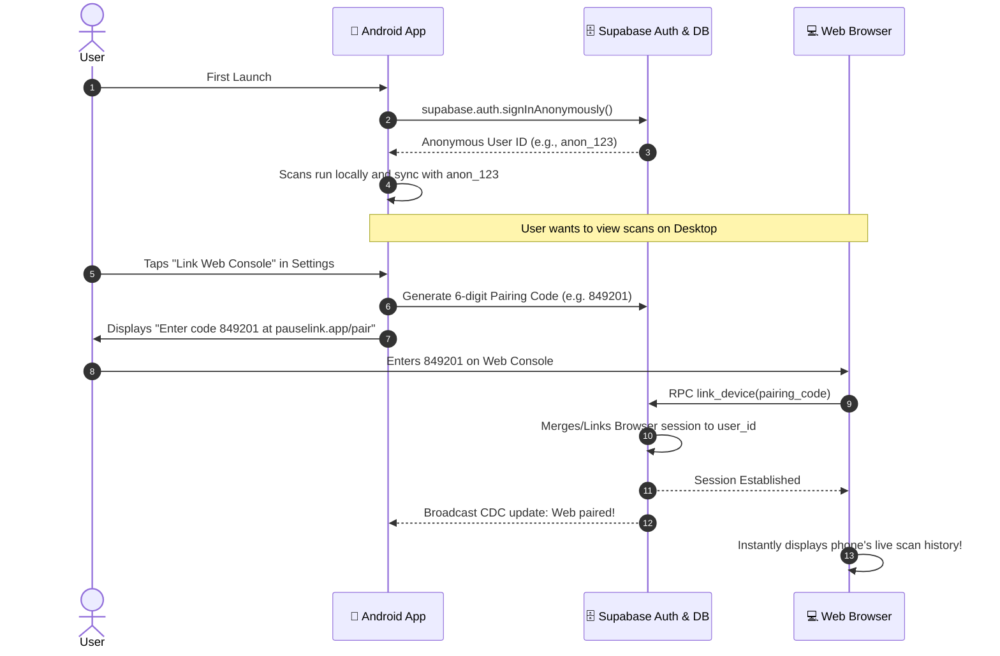

# Design Document: PauseLink Web & Android Unified Ecosystem with Supabase Realtime Sync

**Date:** 2026-11-14  
**Author:** Antigravity  
**Status:** PROPOSED (Awaiting User Sign-off)

---

## 1. Intent & Context

PauseLink is an offline-first, deterministic, explainable link and message analysis Android application. While the native Android application provides immediate, isolated heuristic scanning directly on the device, users need the ability to view, manage, and analyze suspicious links across desktop browsers and share synchronized scan histories across devices.

This project expands PauseLink into a cross-platform ecosystem consisting of:
1. **Next.js 15 Web Application**: A desktop-friendly threat console with live analysis, reactive history tables, and security explanations.
2. **Native Android Application**: The existing Kotlin Compose app upgraded with an optional background sync layer.
3. **Supabase Cloud Backend**: PostgreSQL database with Row Level Security (RLS) and Change Data Capture (CDC) over WebSockets for instant, bidirectional state synchronization.

---

## 2. Goals, Non-Goals & Anti-Goals

### Goals
- **Real-Time Cross-Device Sync**: Any scan conducted on Android reflects on Web in real time (<100ms via Postgres CDC), and mutations made on Web (deletions, setting adjustments) reflect immediately on Android.
- **Offline-First Android App**: The Android app remains 100% functional without an active internet connection. Scans are saved to local Room DB first and queued for cloud synchronization once network is restored.
- **Anonymous-First Authentication (Option A)**:
  - Android starts with an anonymous Supabase session immediately (zero barrier to entry).
  - Users can seamlessly link or upgrade their account using OAuth (Google) or Magic Link to pair their web browser console.
  - Web users can log in via Google/Email or enter a 6-digit Device Pairing Code to associate their browser with their phone.
- **Unified Monorepo Architecture**: Turborepo workspace organizing `apps/web`, `apps/android`, `packages/types`, and `packages/supabase-config`.

### Non-Goals
- We are **not** rewriting the Android `:analyzer` engine into JavaScript. The Android app retains its high-speed pure Kotlin/JVM deterministic engine; the Web app implements an equivalent TypeScript heuristic runner using identical shared rule IDs, score weights, and evidence structures.
- We are **not** introducing outbound network pings to target URLs. Neither the Web App nor the Android App will ever fetch, expand, or preview untrusted links over the public internet.

### Anti-Goals
- Never block local scanning on Android if Supabase is unreachable or in airplane mode.
- Never log raw URLs or sensitive message contents in server telemetry.

---

## 3. Approaches Considered & Rationale

| Approach | Architecture | Trade-offs & Evaluation | Decision |
|---|---|---|---|
| **Approach 1 (Selected)** | **Next.js 15 + Supabase / Postgres CDC** | **Pros:** Zero custom WebSocket server code; out-of-the-box OAuth + Anonymous Auth; native Kotlin SDK (`supabase-kt`) and TypeScript SDK; instant database replication.<br/>**Cons:** Tied to Postgres CDC architecture. | **SELECTED** (Fastest time-to-market, industry benchmark for reactive apps). |
| **Approach 2** | Kotlin Multiplatform (Ktor + Compose Web) | **Pros:** 100% code reuse of `:analyzer` module.<br/>**Cons:** Compose for Web is still maturing; smaller web ecosystem compared to React/Next.js. | Rejected for Web UI, though KMP analyzer could be explored in future. |
| **Approach 3** | Custom Node.js/Hono + Redis + Socket.io | **Pros:** Maximum protocol control.<br/>**Cons:** Heavy operational overhead: must maintain custom WebSocket hub, auth tokens, Redis cluster, and reconnection handling. | Rejected due to unnecessary maintenance burden. |
| **Approach 4** | Firebase / Cloud Firestore | **Pros:** Turnkey offline sync.<br/>**Cons:** Proprietary NoSQL schema; harder to do complex relational joins and deterministic aggregations compared to PostgreSQL. | Rejected in favor of open-source PostgreSQL. |

---

## 4. Architectural Specifications

### 4.1 Monorepo Topology (Turborepo)
```
pauselink-workspace/
├── apps/
│   ├── web/                     # Next.js 15 App Router (React 19, Tailwind CSS, shadcn/ui)
│   └── android/                 # Native Android App (Jetpack Compose, Hilt, Room, :analyzer)
├── packages/
│   ├── types/                   # Shared TypeScript definitions matching Kotlin models
│   └── supabase-config/         # PostgreSQL DDL migrations, RLS security policies, seed scripts
├── package.json                 # Turborepo root workspace
└── turbo.json
```

### 4.2 Database Schema & Security (PostgreSQL)

```sql
-- Profiles & Authentication
CREATE TABLE public.profiles (
    id UUID PRIMARY KEY REFERENCES auth.users(id) ON DELETE CASCADE,
    email TEXT,
    is_anonymous BOOLEAN DEFAULT FALSE,
    pairing_code VARCHAR(6),
    pairing_code_expires_at TIMESTAMPTZ,
    device_sync_enabled BOOLEAN DEFAULT TRUE,
    created_at TIMESTAMPTZ DEFAULT NOW(),
    updated_at TIMESTAMPTZ DEFAULT NOW()
);

-- Scans Table
CREATE TABLE public.scans (
    id UUID PRIMARY KEY DEFAULT gen_random_uuid(),
    user_id UUID NOT NULL REFERENCES public.profiles(id) ON DELETE CASCADE,
    source TEXT NOT NULL CHECK (source IN ('SHARED_TEXT', 'PROCESS_TEXT', 'PASTED', 'QR_CODE', 'WEB_PASTE')),
    input_text TEXT NOT NULL,
    overall_score INT NOT NULL,
    risk_band TEXT NOT NULL CHECK (risk_band IN ('NO_WARNING_SIGNS', 'NOTICE', 'CAUTION', 'STRONG_WARNING')),
    links_count INT NOT NULL DEFAULT 0,
    report_json JSONB NOT NULL,
    device_origin TEXT NOT NULL CHECK (device_origin IN ('ANDROID', 'WEB')),
    created_at TIMESTAMPTZ DEFAULT NOW()
);

-- Realtime CDC Publications
ALTER PUBLICATION supabase_realtime ADD TABLE public.scans;
ALTER PUBLICATION supabase_realtime ADD TABLE public.profiles;

-- Row Level Security (RLS)
ALTER TABLE public.profiles ENABLE ROW LEVEL SECURITY;
ALTER TABLE public.scans ENABLE ROW LEVEL SECURITY;

CREATE POLICY "Users can only view/edit own profile"
    ON public.profiles FOR ALL
    USING (auth.uid() = id);

CREATE POLICY "Users can only view/insert/delete own scans"
    ON public.scans FOR ALL
    USING (auth.uid() = user_id);
```

### 4.3 Authentication & Account Pairing Flow (Option A)



---

## 5. Implementation Phases & Milestones

1. **Phase 1: Workspace & Supabase Infrastructure**
   - Initialize Turborepo root workspace.
   - Set up `packages/types` and `packages/supabase-config` with SQL migrations and RLS tests.
   - Configure Supabase project / local dev environment.
2. **Phase 2: Next.js 15 Web Application**
   - Scaffold `apps/web` with Next.js 15, Tailwind CSS, shadcn/ui, TanStack Query.
   - Build Authentication pages (Magic Link, Google, Pairing Code).
   - Build Real-Time Scan Console, History Table, and Security Breakdown dialogs.
3. **Phase 3: Android Cloud Sync Integration**
   - Integrate `io.github.jan-tennert.supabase:postgrest-kt`, `realtime-kt`, and `auth-kt`.
   - Implement `Room` $\leftrightarrow$ `Supabase` sync engine with background `CoroutineWorker`.
   - Add Device Pairing & Cloud Sync toggle in Android Settings screen.
4. **Phase 4: End-to-End Cross-Platform Verification**
   - Verify live dual-screen test: Scan on Android $\rightarrow$ shows on Web within 100ms.
   - Verify live deletion test: Delete on Web $\rightarrow$ disappears from Android Room DB immediately.
   - Verify offline queue: Scan offline on Android $\rightarrow$ reconnect $\rightarrow$ verifies batch flush to Supabase.

---

## 6. Sign-off Request

Please review this design document. Once you approve, I will proceed to create the bite-sized implementation plan using `writing-plans` and begin scaffolding the workspace.
